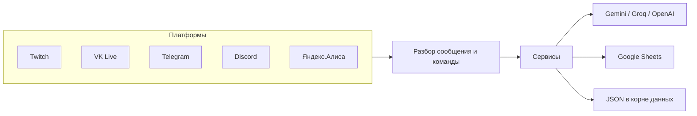

# AbsoluteBot

**AbsoluteBot** — кросс-платформенный чат-бот на .NET 8 для стрима. Он живёт в Twitch, VK Live, Telegram и Discord, отвечает на команды, модерирует чат, ведёт учёт игр и общается через нейросеть. Если у платформы нет ключей, бот продолжает работать на остальных.

Каталог команд — ниже. Устройство слоёв, данных и деплоя — в [architecture.md](architecture.md). В этом репозитории лежат проект `AbsoluteBot`, тесты, Docker и скрипты обновления.

## Содержание

- [Стек](#стек)
- [Запуск](#запуск)
- [Тесты](#тесты)
- [Основные функции](#основные-функции)
- [Скриншоты](#скриншоты-работы-absolutebot)
- [Архитектура](#архитектура-программы)
- [Конфигурация](#гибкость-конфигурации-и-сервисов)
- [Файлы данных](#структура-файлов)

## Стек

- .NET 8, внедрение зависимостей через `Microsoft.Extensions.DependencyInjection`
- Чаты: Discord.Net, Telegram.Bot, TwitchLib, собственный клиент VK Live (WebSocket)
- Нейросети: Gemini и Groq как сменяемый провайдер, отдельный клиент OpenAI, генерация картинок через Cloudflare Workers AI
- Google Sheets, DeepL, Serilog
- Эмбеддинги ачивок: ONNX Runtime (`multilingual-e5-small`), сейчас выключены флагом
- Docker (Debian slim) и xUnit-тесты в `AbsoluteBotTests`

## Запуск

Нужен SDK .NET 8. Корень данных — каталог с `config.json`. Его задаёт переменная `ABSOLUTEBOT_DATA_ROOT`. Если переменная пустая или путь не существует, бот берёт текущую директорию.

Скопируйте [BeginData/config.example.json](BeginData/config.example.json) в `BeginData/config.json` и заполните ключи тех платформ, которые нужны. Пустые ключи просто оставляют платформу выключенной.

```powershell
$env:ABSOLUTEBOT_DATA_ROOT = (Resolve-Path .\BeginData)
dotnet run --project AbsoluteBot\AbsoluteBot.csproj
```

```bash
export ABSOLUTEBOT_DATA_ROOT="$(pwd)/BeginData"
dotnet run --project AbsoluteBot/AbsoluteBot.csproj
```

`Dockerfile` собирает проект из каталога `AbsoluteBot/`. Каталог данных задаётся `ABS_DATA_DIR`, по умолчанию `./data`, и монтируется в `/app`. Порт 5000.

```bash
docker compose up --build
```

Навык Яндекс.Алисы ходит в `POST /Sobeka`: тот же текстовый разбор команд, что и в чате. Если ответ не успевает за пару секунд, навык просит подождать и отдаёт результат следующим запросом той же сессии.

Рабочие `config.json`, `google_sheets_credentials.json`, истории чата и персональные JSON (роли, дни рождения, MBTI/SBTI, жалобы, автоперевод) в этот репозиторий не входят.

## Тесты

Безопасный прогон не подключается к боевым чатам и не требует VPN:

```bash
dotnet test AbsoluteBot.sln --settings AbsoluteBotTests/unit.runsettings
```

Живые проверки нейросети, Google Sheets и эмбеддингов вынесены в отдельные traits и в этот набор не входят. Подробности — в [architecture.md](architecture.md).

## Основные функции

### Интерактивное общение и нейросеть

Бот ведёт диалог как участник чата и помнит недавний контекст, включая последнее изображение. Провайдер чата и коротких ответов — Gemini или Groq, его выбирает `neural_models.json`. Для Groq в запрос уходит урезанная история, чтобы не сжигать дневной лимит токенов.

- Обращение `@имя_бота` — поговорить с ботом.
- `!спросить [вопрос]` — ответ через отдельный клиент OpenAI.
- `!!спросить [вопрос]` — ответ через текущий провайдер Gemini или Groq, понимает изображение в сообщении.
- `!загугли [вопрос]` — ответ с поиском в интернете через текущий провайдер.
- `!!загугли [запрос]` — краткая сводка по страницам из Google.
- `!нарисуй [запрос]` — картинка через Cloudflare FLUX.2 klein; если в сообщении уже есть изображение, бот правит его.
- `!сгенерировать [запрос]` — картинка через Flux 1 schnell.
- `!амнезия` — сброс памяти диалога, настройки личности остаются.
- В административном канале: `!switchai [gemini|groq]`, `!showmodels`, `!setmodel [сущность] [провайдер] [id модели]`.

Бот может сам вызывать свои команды, например `!картинка` или `!игнор`. Личность и сведения о чате задаются промптом в файлах `initialUserMessage.txt` и `initialModelMessage.txt`.

Человек на платформе определяется по id. После смены ника к той же личности остаются MBTI, SBTI, роли, дни рождения, автоперевод и статистика сообщений на стриме.

### Оповещения о начале стримов

При старте трансляции бот пишет в заданные каналы Discord и Telegram. Сообщения чата Twitch пересылаются в VK Live одной строкой вида `[Twitch] ник: текст`. За сессию стрима считается, сколько сообщений написал каждый чаттер на Twitch и VK Live.

### Праздники и ежедневные уведомления

- `!праздник` — праздник текущего дня.
- Раз в день в Telegram уходит короткая заметка о празднике, собранная нейросетью.

### Автоматическое исправление раскладки

Если фраза набрана в английской раскладке вместо русской, бот присылает исправленный текст и может выполнить так введённую команду.

### Перевод и автоперевод

Перевод идёт через DeepL.

- `!переведи [текст]` — с русского на английский или с другого языка на русский.
- `!перевод [ник]` — включает или выключает автоперевод сообщений этого пользователя. Команда для модератора и администратора.

### Фильтрация сообщений

Слова из списка заменяются на слово из настройки `ReplacementWordForCensor`. Команды ниже работают в административном канале.

- `!добавитьцензуру [слово]`
- `!удалитьцензуру [слово]`
- `!цензура` — текущий список.

### Система ролей

Роли: **Default**, **Premium**, **Moderator**, **Administrator**, **Ignored** и **Bot**. Ignored не получает ответов на команды. Premium, Moderator, Administrator и Bot не ждут перезарядку.

- `!игнор [ник]` — добавляет пользователя в игнор. Доступно модератору, администратору и самому боту.
- `!перезарядка [секунды]` — пауза между командами обычных пользователей на текущей платформе. Модератор и администратор.

### Прогресс прохождения игр

- `!прогресс` — процент прохождения текущей игры по HowLongToBeat и времени на стриме. Данные сохраняются между запусками.

### Дни рождения

Бот поздравляет пользователя с первым сообщением в день рождения и отдельно поздравляет в Telegram по таймеру.

- `!добавитьдр [день месяц]` — запомнить свой день рождения.
- `!удалитьдр` — убрать свою дату.
- `!др` — дни до ближайшего дня рождения среди зарегистрированных.
- `!др [ник]` — дни до дня рождения конкретного человека.
- `!списокдр` — все даты и то, включены ли поздравления на платформах. Административный канал.

### MBTI и SBTI

- `!mbti [четыре буквы]` — записать свой тип.
- `!mbti [ник]` — тип другого пользователя.
- `!whombti` — персонаж последней игры на стриме по MBTI. Можно передать игру или ник.
- `!sbti [код или ник]` — записать или показать мемный тип личности (например `NPC`, `BOSS`, `JOKE-R`).
- `!whosbti` — персонаж игры по SBTI, для себя или выбранного пользователя.

### Учёт игр и стримов в Google Sheets

Таблица обновляется по ходу стрима: прогресс, оценки, комментарии.

- `!оценка [0-10]` — оценка чата текущей игре.
- `!обигре` — отзыв и данные по текущей игре.
- `!обигре [игра]` — то же для игры, которая уже была на стриме.

### Система жалоб

- `!жалоба [текст]` — отправить жалобу на работу бота.
- `!жалобы` — список жалоб в административном канале или в премиум-канале Telegram.

### Медиа и справочные команды

- `!команды` — список команд, доступных этому пользователю на этой платформе.
- `!видео [запрос]` — ролик с YouTube.
- `!картинка [запрос]` и `!картинки [запрос]` — поиск изображений.
- `!спойлеркартинка [запрос]` и `!спойлеркартинки [запрос]` — то же, спрятанное под спойлер.
- `!гифка [запрос]` — GIF.
- `!котик` — случайный кот.
- `!сходство [имя]` — похожая знаменитость.
- `!клип` — клип текущего стрима на Twitch; с текстом ищет уже сделанный клип.
- `!совет` — совет по текущей игре на стриме. Без текста смотрит кадр эфира, с текстом отвечает на вопрос. Кадр берётся с живого плейлиста Twitch, не с превью.
- `!чтобыло` — пересказ. В чате Twitch и VK Live по умолчанию текущий или последний стрим, оба чата вместе. В премиум-канале Telegram или Discord по умолчанию своя переписка. Срок задаётся хвостом: `вчера`, `со вчера`, `3 дня назад`, `за неделю`, `на прошлом`. На стриме ответ короче 500 символов.
- `!вопрос [вопрос]` — ответ в духе Ответов Mail.ru.
- `!факт` — случайный факт.
- `!мудрость` — цитата из списка стримера.
- `!добавитьмудрость [текст]` — добавить цитату. Модератор и администратор.
- `!анимудрость` — цитата из случайного или указанного аниме.
- `!гороскоп` — гороскоп на ближайшее время.
- `!определение [запрос]` — короткое определение.
- `!отклонение` — текущее «отклонение от мировой линии».
- `!позвать [ник]` — позвать пользователя в Discord.

### Курс валют, напоминания, удаление сообщений

Раз в день бот присылает график рубля к евро и доллару.

- `!напомнить [минуты] [текст]` — напомнить через заданное время. Модератор и администратор.
- `!удалить [число]` — удалить до 15 последних сообщений. Только администратор.

### Команды управления ботом

Только администратор:

- `!выключить` — остановить процесс.
- `!перезагрузка` — локально поднимает новый процесс. В Docker процесс завершается, контейнер поднимает политика `restart`.
- `!обновить` — пишет флаг `update.requested` в корень данных. Сборку и `git pull` делает watcher на хосте, из контейнера git и docker не вызываются.
- `!статускоманды [команда] [платформа]` — включить или выключить команду на платформе. Административный канал.
- `!статускоманд` — статусы команд по платформам. Административный канал.
- `!setconfig [ключ] [значение]` и `!showconfig` — правка и просмотр конфигурации. Административный канал.

### Дополнительные динамические команды

Модератор и администратор могут завести команду с фиксированным ответом:

- `!добавитькоманду [название] [ответ]`
- `!удалитькоманду [название]`

### Ачивки

Учёт ачивок по смыслу сообщений написан и покрыт тестами, но на старте выключен: `ChatAchievementService.Enabled = false`. Классификация идёт эмбеддингами ONNX, без ключевых слов и без запроса в Gemini или Groq. В чат результаты не пишутся.

## Скриншоты работы AbsoluteBot

Ниже примеры с Twitch, VK Live, Discord и Telegram: оповещения, список команд, диалог с картинкой, игнор, исправление раскладки и таблица игр. Один и тот же набор команд доступен на подключённых платформах.

### 1. Работа на разных платформах

#### 1.1 Оповещения и уведомления

**Скриншот: уведомление о начале стрима (Discord)**


#### 1.2 Работа с командами

**Скриншот: список команд (Discord)**

Команда `!команды` собирает список по роли, платформе и тому, включена ли команда.


#### 1.3 Контекстное общение и работа с изображениями

**Скриншот: диалог и капча (Discord)**


**Скриншот: оценка мема (Discord)**


#### 1.4 Игнорирование пользователя

**Скриншот: бот сам вызывает `!игнор` (Telegram)**


#### 1.5 Исправление раскладки и прогресс игры

**Скриншот: раскладка и `!прогресс` (Twitch)**


#### 1.6 Команды на VK Live

**Скриншот: `!загугли` (VK Live)**


### 2. Интеграция с внешними сервисами

**Скриншот: таблица игр в Google Sheets**


## Архитектура программы

Подробная схема слоёв, корня данных, Docker и тестов — в [architecture.md](architecture.md). Ниже — каркас, на котором держится код.



Платформы подключены отдельными реализациями `IChatService` (`TwitchChatService`, `VkPlayChatService`, `TelegramChatService`, `DiscordChatService`). Сообщения приходят событием и попадают в общий разбор команд.

Команды регистрируются в `CommandRegistry`. Большинство наследует `BaseCommand` или `BaseMediaCommand` и проходит общий шаблон: проверка прав, параметры, ответ в чат. `CommandsListCommand`, `ExecuteExtraCommand` и команды генерации картинок реализуют `IChatCommand` напрямую.

Фоновые задачи (`ScheduledTaskService`) стартуют вместе с процессом: стрим, праздник, курс валют, поздравления. Логи пишет Serilog, отдельно для подключений и для остальных событий.

Перезапуск и остановка идут через `IProcessController`, поэтому команды не вызывают `Environment.Exit` напрямую и покрываются тестами. В unit-тестах платформы заменены на `FakeChatService`: живой `Connect` к боевым аккаунтам тесты не делают.

## Гибкость конфигурации и сервисов

Бот рассчитан на неполную настройку.

- Нет токена платформы — эта платформа молчит, остальные работают.
- Нет ключа внешнего API — молчит только функция, которой он нужен.
- Модели Gemini и Groq меняются из административного канала без перезапуска.

Образец ключей: [BeginData/config.example.json](BeginData/config.example.json). Для Google Sheets в `BeginData` кладётся свой `google_sheets_credentials.json`, его в репозитории нет.

## Структура файлов

Корень данных локально — `BeginData`, в Docker — volume `./data`. В репозиторий из него входят образец конфига, каталог ачивок, модели нейросети, каталоги персонажей, праздники и словари раскладки. Рабочее состояние чата остаётся только на диске.

В репозитории:

- [BeginData/config.example.json](BeginData/config.example.json) — ключи без значений.
- `BeginData/neural_models.json` — провайдер и id моделей.
- `BeginData/achievements.json` — каталог ачивок. На деплое копируется в volume данных.
- `BeginData/mbti_characters.json`, `BeginData/sbti_characters.json` — каталоги персонажей.
- `BeginData/holidays.json` — праздники.
- `BeginData/en_US.dic`, `BeginData/ru_RU.dic` и файлы `.aff` — словари исправления раскладки.
- `BeginData/vkplay_request_cookies.txt.example` — шаблон cookie без секрета.

Только локально, в git не входят:

- `config.json` — токены и id каналов.
- `google_sheets_credentials.json` — ключ сервисного аккаунта Google.
- `ChatHistory_*.json` — память диалогов.
- `user_roles.json`, `user_birthdays.json`, `user_identities.json`.
- `mbti_data.json`, `sbti_data.json`, `auto_translate_users.json`, `complaints.json`.
- `commands.json`, `extra_commands.json`, `cooldowns.json`, `wisdoms.json`, `clips.json`, `gamesRates.json`, `game_progress.json`, `censor_words.json`.
- `initialUserMessage.txt`, `initialModelMessage.txt` — промпт личности.
- `vkplay_request_cookies.txt` — рабочие cookie VK Live.
- `stream_stats/` — счётчики сообщений сессии стрима.

## Заключение

AbsoluteBot закрывает рутину стрим-чата сразу на нескольких площадках: команды, модерацию, перевод, таблицу игр и диалог с нейросетью. Провайдер модели меняется без переделки команд, данные пользователя переживают смену ника, а поведение платформ и сервисов покрыто тестами без подключения к боевым аккаунтам.
